# Microservice Architecture — E-Commerce Platform

A production-grade, **microservice e-commerce backend** built with **Go (Golang)**, designed around domain-driven service boundaries. Each business domain — Users, Merchants, Products, Orders, Transactions, Reviews — lives in its own self-contained, independently deployable service communicating via **gRPC** and asynchronous **Kafka** events.

The platform ships with a **full observability stack** (Prometheus, Grafana, Loki, Jaeger, OpenTelemetry), **Redis caching** with instrumented metrics, **circuit-breaker & rate-limiting** resilience patterns (centralized via a gRPC interceptor), **six standalone MongoDB instances — strictly one database per MongoDB**, and **Kustomize + ArgoCD** GitOps manifests featuring Horizontal Pod Autoscalers (HPA) for every service.

---

## Key Features

| Domain | Capabilities |
|--------|-------------|
| **Auth & Users** | Registration, login, JWT access/refresh tokens, role-based authorization (RBAC), password reset flows |
| **Merchants** | Merchant onboarding, business details, verification documents, social links, policies, awards |
| **Products & Inventory** | Full CRUD for products & categories, stock tracking, pricing, rich descriptions |
| **Cart & Orders** | Add-to-cart, checkout, order lifecycle management, order-item decomposition |
| **Transactions** | Payment recording, status tracking, event-driven confirmation pipelines |
| **Reviews** | Product ratings & detailed review submissions post-purchase |
| **Notifications** | Kafka-driven email service for merchant confirmations, account verification, password resets, transaction updates |
| **OLAP Analytics** | ClickHouse event warehouse (order / order-item / transaction events) fed by the `stats_writer` Kafka consumer and queried by the `stats_reader` gRPC service |
| **Observability** | Metrics (Prometheus + Grafana), Logging (Loki + Promtail), Tracing (Jaeger + OpenTelemetry), System metrics (Node Exporter), Kafka metrics (Kafka Exporter) |
| **Deployment** | Docker Compose for local dev (full-stack and infra-only variants), Kustomize + ArgoCD GitOps manifests with HPA for production |

---

## Architecture Overview

The platform follows a **Microservice Architecture** — each service is a self-contained Go binary with its own clean-architecture internals, deployed as an independent container. An **API Gateway** (NGINX + Chi) provides a unified **REST API** entry point, translating HTTP REST requests into gRPC calls to downstream services.

### Core Architecture Principles

- **Single Responsibility**: Each microservice owns its domain logic, data access, and caching layer
- **Clean Architecture**: Every microservice follows `handler → service → repository` with clear dependency injection
- **One Database = One MongoDB**: The six bounded contexts (`ec_identity`, `ec_catalog`, `ec_merchant`, `ec_sales`, `ec_experience`, `ec_email`) each get their **own dedicated standalone MongoDB server**. `pkg/database/names.go` is the source of truth for the names, and `ContextPrefix()` maps each name to its env prefix (`MONGO_IDENTITY`, `MONGO_CATALOG`, `MONGO_MERCHANT`, `MONGO_SALES`, `MONGO_EXPERIENCE`, `MONGO_EMAIL`). Each service declares its database via `Config.DBName` (fail-hard — an empty name aborts startup) and cross-context access goes through gRPC, never a shared database handle.
- **Adapter Boundary**: Outbound gRPC clients live in `pkg/adapter/<domain>/`, never in `service/*/repository/` — the repository layer talks only to MongoDB
- **Event-Driven Decoupling**: Kafka enables asynchronous communication without direct service dependencies
- **Observability-First**: Every microservice is instrumented with OpenTelemetry traces, Prometheus metrics, and structured logging
- **Resilience Patterns**: Circuit breakers, request rate limiters, and load monitors in `pkg/resilience`, applied once per connection via `DependencyGuardInterceptor` at the dial site

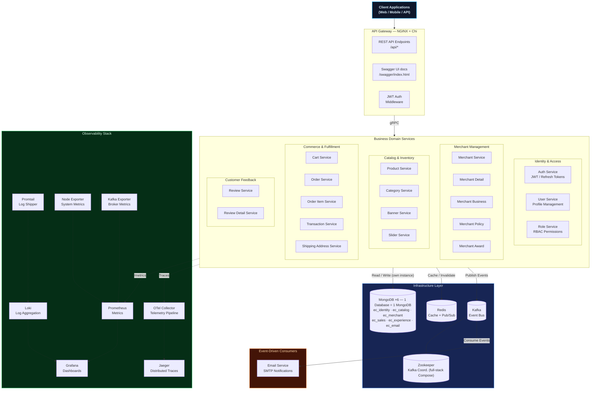

---

## Database Topology

**One database = one MongoDB.** There are six bounded contexts, therefore **six independent standalone MongoDB servers** — no replica set, no shared cluster. The source of truth for the names is `pkg/database/names.go`; `ContextPrefix()` maps each name to the env prefix that points at its server. Each service sets `Config.DBName` in its `cmd/main.go`, and the server **fails hard at startup** if it is empty (there is no silent default database).

| Database | MongoDB instance (local port) | Kubernetes Service | Owning services | Collections |
| :--- | :--- | :--- | :--- | :--- |
| `ec_identity` | `mongodb_identity` (`:27017`) | `mongodb-identity` | `auth`, `user`, `role` | `users`, `roles`, `user_roles`, `refresh_tokens`, `reset_tokens` |
| `ec_catalog` | `mongodb_catalog` (`:27018`) | `mongodb-catalog` | `category`, `product` | `categories`, `products`, `product_stock_adjustments` |
| `ec_merchant` | `mongodb_merchant` (`:27019`) | `mongodb-merchant` | `merchant`, `merchant_award`, `merchant_business`, `merchant_detail`, `merchant_policy` | `merchants`, `merchant_documents`, `merchant_details`, `merchant_social_media_links`, `merchant_business_information`, `merchant_policies`, `merchant_certifications_and_awards` |
| `ec_sales` | `mongodb_sales` (`:27020`) | `mongodb-sales` | `order`, `order_item`, `transaction` | `orders`, `order_items`, `order_stock_reservations`, `transactions` |
| `ec_experience` | `mongodb_experience` (`:27021`) | `mongodb-experience` | `cart`, `shipping_address`, `banner`, `slider`, `review`, `review_detail` | `carts`, `shipping_addresses`, `banners`, `sliders`, `reviews`, `review_details` |
| `ec_email` | `mongodb_email` (`:27022`) | `mongodb-email` | `email` | `outbox_events`, `consumer_inbox` |

Each instance is reached through its own env prefix, and every prefix falls back to the legacy single-instance keys when unset:

| Context | Env prefix | Connection keys read |
| :--- | :--- | :--- |
| `ec_identity` | `MONGO_IDENTITY` | `MONGO_IDENTITY_URI` → `MONGO_IDENTITY_HOST` / `_PORT` / `_USERNAME` / `_PASSWORD` |
| `ec_catalog` | `MONGO_CATALOG` | `MONGO_CATALOG_URI` → `MONGO_CATALOG_HOST` / `_PORT` / … |
| `ec_merchant` | `MONGO_MERCHANT` | `MONGO_MERCHANT_URI` → `MONGO_MERCHANT_HOST` / `_PORT` / … |
| `ec_sales` | `MONGO_SALES` | `MONGO_SALES_URI` → `MONGO_SALES_HOST` / `_PORT` / … |
| `ec_experience` | `MONGO_EXPERIENCE` | `MONGO_EXPERIENCE_URI` → `MONGO_EXPERIENCE_HOST` / `_PORT` / … |
| `ec_email` | `MONGO_EMAIL` | `MONGO_EMAIL_URI` → `MONGO_EMAIL_HOST` / `_PORT` / … |

Notes:

- **Transactional outbox per publisher.** Each publisher (`auth`, `merchant`, `order`, `transaction`) writes `outbox_events` into its **own** context database, not a shared one.
- **Two intentional cross-context accesses now open a second connection.** `review` reads `ec_catalog.products` and `order` deletes from `ec_catalog.product_stock_adjustments`. Because `ec_catalog` lives on a different server, these go through `srv.ContextDatabase(database.CatalogDB)`, which lazily opens and caches a **second Mongo client** (closed in `Cleanup`) instead of reusing the service's own client.
- **`stats_writer` backfill** reads from two contexts (`ec_sales` + `ec_catalog`) and therefore holds two clients, both disconnected in `Backfiller.Close()`.
- `apigateway` and `stats_reader` do not touch MongoDB at all.
- `migrate` is the only multi-context tool: `database.EnsureIndexes` opens one client per context via `NewMongoClientForContext` and closes each before moving on. The integration harness, which runs all six contexts on a single container, uses `database.EnsureIndexesOnClient` instead.
- Legacy data in the old single `ecommerce` database is migrated with `scripts/split-databases.js` (dry-run by default).

---

## Service Catalog

The `service/` directory holds **25 Go modules** — **23 runtime services** plus the `migrate` (index bootstrap) and `seeder` (dev data) jobs. Only **21 of the runtime services are currently deployed** (Compose full-stack and the Kustomize base); `stats_reader` and `stats_writer` exist in the workspace but have no deployment manifests yet.

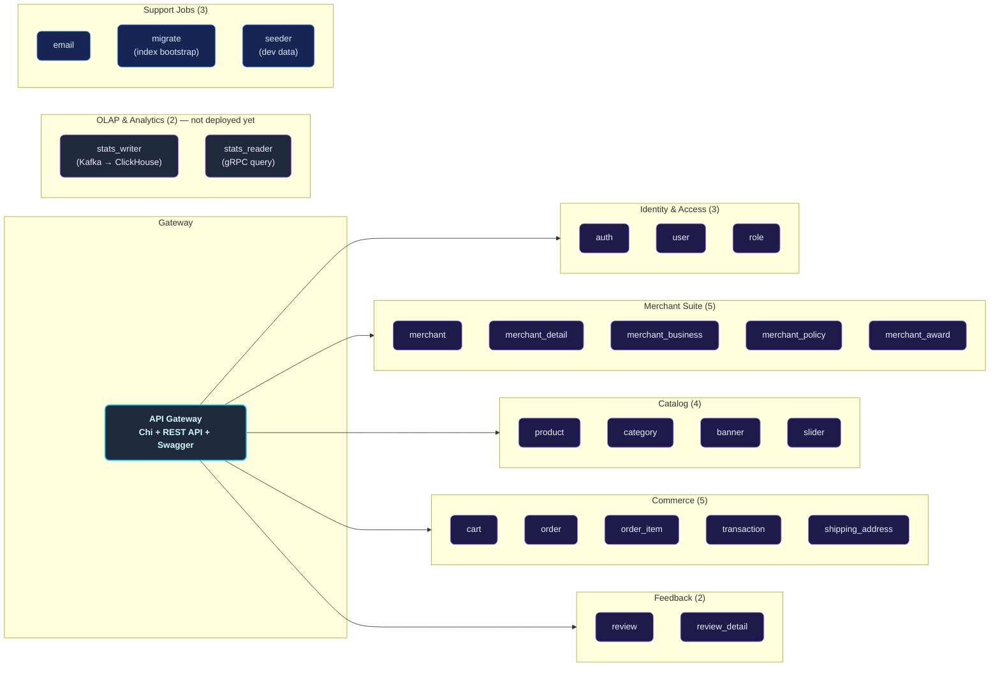

---

## Internal Service Architecture

Every business service follows a **Clean Architecture** pattern with strict layering. Dependencies flow inward, keeping the core business logic free from infrastructure concerns.

```mermaid
graph TB
    classDef handler fill:#1e3a5f,stroke:#7dd3fc,color:#e0f2fe,stroke-width:1.5px
    classDef service fill:#1e1b4b,stroke:#a78bfa,color:#ede9fe,stroke-width:1.5px
    classDef repo fill:#172554,stroke:#60a5fa,color:#dbeafe,stroke-width:1.5px
    classDef infra fill:#052e16,stroke:#4ade80,color:#dcfce7,stroke-width:1.5px
    classDef shared fill:#431407,stroke:#fb923c,color:#fed7aa,stroke-width:1.5px

    subgraph Service["service/<name>/"]
        direction TB

        CMD["cmd/main.go<br/>Entry Point"]

        APPS["apps/server.go<br/>Dependency Wiring"]:::handler
        HANDLER["handler/<br/>gRPC Handlers"]:::handler
        MW["middleware/<br/>Interceptors"]:::handler
        SVC["service/<br/>Business Logic"]:::service
        CACHE["cache/<br/>Redis Cache Layer"]:::service
        REPO["repository/<br/>Data Access (MongoDB only)"]:::repo

        CMD --> APPS
        APPS --> HANDLER
        APPS --> SVC
        APPS --> CACHE
        APPS --> REPO
        HANDLER --> SVC
        SVC --> REPO
        SVC --> CACHE
    end

    subgraph SharedLibs["shared/ — Shared Libraries"]
        direction LR
        DOMAIN["domain/<br/>record / requests / response"]:::shared
        OBS["observability/<br/>cache_metrics / tracing_metrics"]:::shared
        CACHESHARED["cache/<br/>redis_cache.go"]:::shared
        MAPPER["mapper/<br/>Domain ↔ Proto"]:::shared
        CONVERT["convert/<br/>BSON helpers"]:::shared
        ERRORS["errors/ + errorhandler/"]:::shared
    end

    subgraph PkgLibs["pkg/ — Platform Libraries"]
        direction LR
        PKGADAPTER["adapter/<domain>/<br/>9 gRPC Client Adapters"]:::infra
        PKGAUTH["auth/<br/>JWT Manager"]:::infra
        PKGKAFKA["kafka/<br/>Producer / Consumer"]:::infra
        PKGOTEL["otel/<br/>Tracing + Metrics Init"]:::infra
        PKGRES["resilience/<br/>Circuit Breaker<br/>Rate Limiter<br/>Load Monitor"]:::infra
        PKGLOG["logger/<br/>Zap Structured Logging"]:::infra
        PKGSRV["server/<br/>gRPC Server Bootstrap"]:::infra
        PKGDB["database/<br/>Per-context Mongo clients<br/>names.go (6 DBs)<br/>+ EnsureIndexes"]:::infra
        PB["pb/<br/>Protobuf Generated Code<br/>(separate module)"]:::infra
    end

    REPO --> DOMAIN
    SVC --> DOMAIN
    SVC --> OBS
    HANDLER --> PB
    HANDLER --> MAPPER
    APPS --> PKGSRV
    APPS --> PKGOTEL
    APPS --> CACHESHARED
    APPS --> OBS
    APPS --> PKGADAPTER
```

---

## Data & Event Flow

### Synchronous Flow (gRPC)

All client-facing requests flow through the API Gateway, which forwards them over gRPC to the appropriate domain service.

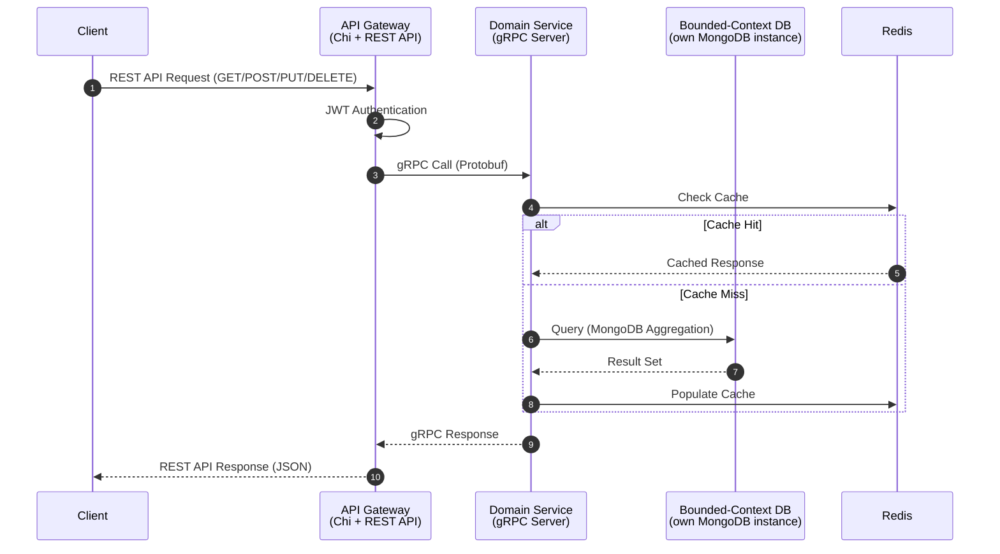

### Asynchronous Flow (Kafka Events)

Services publish domain events to Kafka through a **transactional outbox** (`outbox_events` written into the producer's own context database). Downstream consumers (the Email Service, and the `stats_writer` OLAP consumer) react without coupling to the producer.

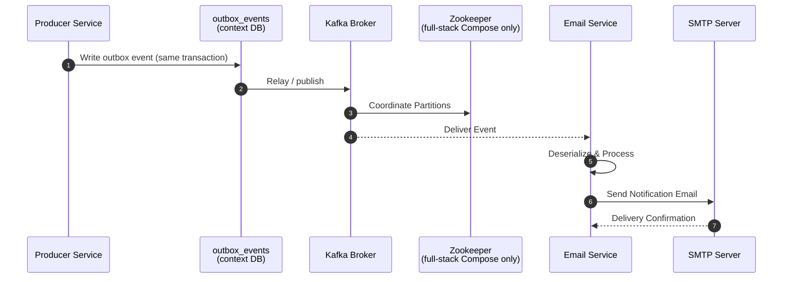

### OLAP Flow (Kafka → ClickHouse)

`stats_writer` consumes order / order-item / transaction events and batch-inserts them into **ClickHouse** tables `order_events`, `order_item_events`, and `transaction_events` (all `ReplacingMergeTree(event_version)`). `stats_reader` exposes the aggregated results over gRPC. The schema is applied idempotently through `pkg/clickhouse/schema.sql` (Compose initdb) or `ApplySchema` at `stats_writer` startup.

> Neither `stats_writer` nor `stats_reader` currently has a Compose or Kubernetes deployment, and ClickHouse itself is only provisioned by `docker-compose.infra.yml`.

---

## Observability Architecture

The platform implements all **Three Pillars of Observability** — Metrics, Logs, and Traces — with a unified visualization layer.

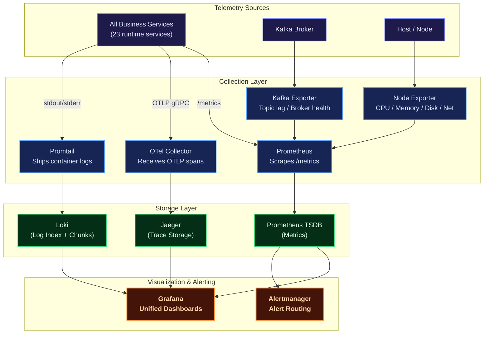

| Pillar | Tool | Purpose |
|--------|------|---------|
| **Metrics** | Prometheus + Grafana | Request rates, error rates, latency percentiles, cache hit ratios, system resource utilization |
| **Logging** | Loki + Promtail | Structured JSON logs from all services, queryable via LogQL in Grafana |
| **Tracing** | Jaeger + OpenTelemetry | End-to-end distributed trace visualization, latency breakdown per service hop |
| **Alerting** | Alertmanager | Alert routing and notification for metric threshold breaches |

---

## Deployment Architectures

### Docker Compose (Local Development)

The Docker Compose setup provides a complete local development environment. There are **two** files:

- `deployments/local/docker-compose.yml` — **full-stack**: 21 app services plus **six standalone MongoDB instances**, Redis, Kafka + Zookeeper, NGINX, and the observability stack.
- `deployments/local/docker-compose.infra.yml` — **infra-only**: the six MongoDB instances, Redis, Kafka (KRaft, no Zookeeper), ClickHouse, and observability, so you can run the Go services directly on the host.

Neither compose file includes a `migrate` or `seeder` service, nor the `stats_writer`/`stats_reader` services.

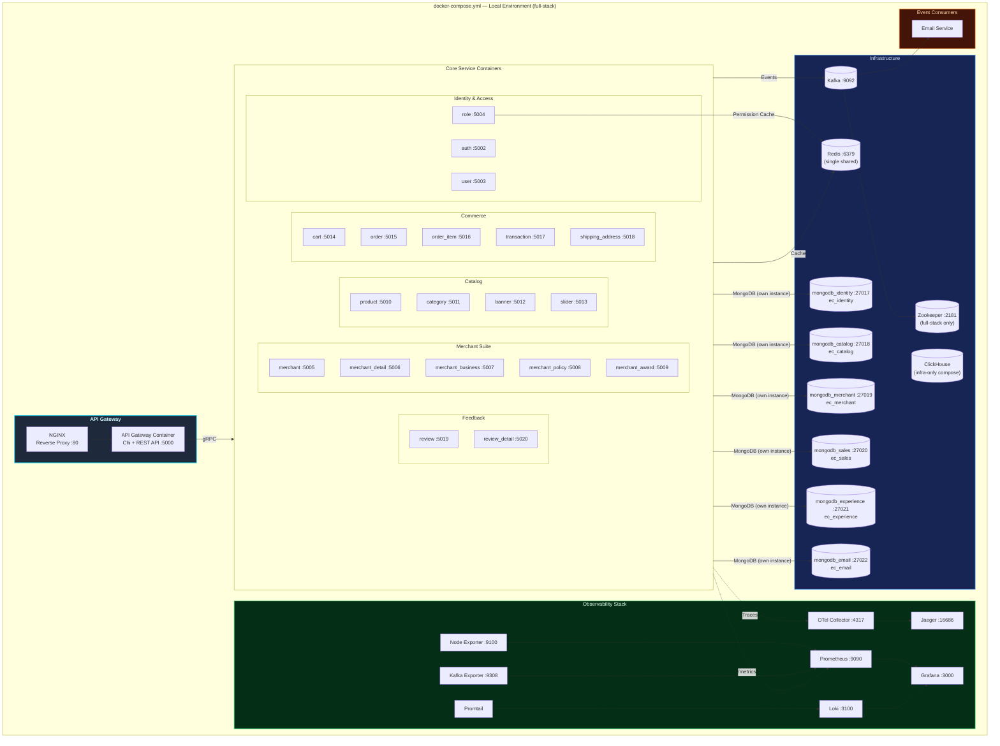

### Kubernetes (Production)

The Kubernetes deployment uses **Kustomize** (`base/` + `overlays/production/`) and is driven by **ArgoCD GitOps** (`deployments/gitops/argocd/`), in the `ecommerce` namespace. Every app service has its own **Deployment**, **Service**, and **HPA** (plus PodDisruptionBudget and NetworkPolicy). The six MongoDB instances now ship as in-cluster manifests under `base/mongodb/`, and the `migrate` Job runs in the **Sync** phase (`sync-wave: "0"`) between MongoDB (`sync-wave: "-1"`) and the services (`sync-wave: "2"`).

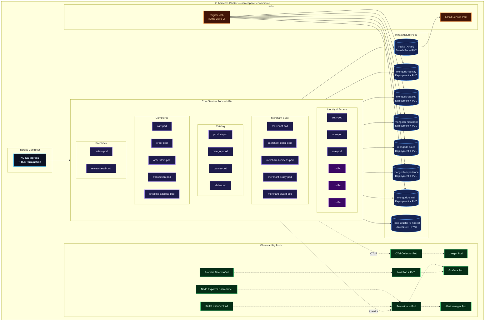

> **Not in the Kustomize base:** `clickhouse`, `stats_reader`, `stats_writer`, and `seeder`. ClickHouse has no manifest, the two stats services are never built by CI, and seeding is a manual host-side step. Kafka runs in **KRaft** mode (no Zookeeper) in-cluster.

#### MongoDB deployment & sync ordering

Each instance lives in `deployments/kubernetes/base/mongodb/` as a single manifest holding its **PersistentVolumeClaim + Deployment + ClusterIP Service** (`mongodb-identity.yaml` … `mongodb-email.yaml`), with one shared `network-policy.yaml` selecting every pod labelled `tier: mongodb`. The overlay pins the ArgoCD **sync-waves** so the dependency chain is explicit:

| Wave | Resource | Why |
| :--- | :--- | :--- |
| `-1` | the six MongoDB Deployments | everything else depends on them |
| `0` | `migrate` Job (`Replace=true`) | needs the databases to exist; runs before the services |
| `2` | the 23 runtime Deployments | last, once indexes are in place |

The `migrate` Job additionally has a `wait-for-mongo` initContainer that polls all six Mongo Services before running, and its own Egress-only NetworkPolicy (`migrate-netpol`). Because the databases are now in-cluster Sync resources rather than external dependencies, `migrate` is no longer an ArgoCD **PreSync hook**. The manual `stats-backfill` Job waits only for the two contexts it reads: `mongodb-sales` and `mongodb-catalog`.

---

## Technology Stack

| Category | Technology | Purpose |
|----------|-----------|---------|
| **Language** | Go (Golang) | High-performance, statically typed backend |
| **API Framework** | Chi | High-performance REST API Gateway framework |
| **RPC** | gRPC + Protobuf | High-performance inter-service communication |
| **Database** | MongoDB 7 | Six standalone MongoDB servers, one bounded-context database each (`ec_identity` … `ec_email`) |
| **ORM** | MongoDB Go Driver | Document-oriented data access with native BSON encoding. |
| **Migrations** | Index bootstrap job | `service/migrate` creates indexes across all six DBs, opening one connection per context (idempotent; no versioning or rollback) |
| **OLAP** | ClickHouse | Columnar event warehouse for `stats_writer`/`stats_reader` (order/order-item/transaction events) |
| **Caching** | Redis | In-memory cache with instrumented metrics |
| **Messaging** | Apache Kafka | Asynchronous event-driven communication |
| **Coordination** | Zookeeper | Kafka cluster coordination (full-stack Compose; infra-only Compose uses KRaft) |
| **Auth** | JWT | Stateless authentication & authorization |
| **Logging** | Zap | High-performance structured logging |
| **Metrics** | Prometheus | Metric collection & alerting rules |
| **Tracing** | Jaeger + OpenTelemetry | Distributed trace collection & visualization |
| **Log Aggregation** | Loki + Promtail | Centralized log storage & shipping |
| **Dashboards** | Grafana | Unified metric, log, and trace visualization |
| **Alerting** | Alertmanager | Alert routing & notification dispatch |
| **System Metrics** | Node Exporter | Host-level CPU / Memory / Disk / Network metrics |
| **Kafka Metrics** | Kafka Exporter | Broker health, topic lag, consumer group metrics |
| **Telemetry Pipeline** | OTel Collector | Vendor-agnostic telemetry receive, process, export |
| **Reverse Proxy** | NGINX | API routing, load balancing, TLS termination |
| **Containerization** | Docker + Docker Compose | Container image building & local orchestration (full-stack and infra-only) |
| **Orchestration** | Kubernetes + Kustomize | Production-grade orchestration with HPA, PDB, and network policies |
| **GitOps** | ArgoCD | `base` + `overlays/production` sync; `migrate` runs at sync-wave 0 between MongoDB (-1) and the services (2) |
| **API Docs** | Swagger | Built-in interactive Swagger UI API documentation |
| **Resilience** | Circuit Breaker, Rate Limiter, Load Monitor | Fault tolerance in `pkg/resilience`, applied via a gRPC dial-site interceptor |

---

## Getting Started

### Prerequisites

Ensure the following tools are installed on your system:

- [Git](https://git-scm.com/)
- [Go](https://go.dev/) (v1.25+)
- [Docker](https://www.docker.com/) & [Docker Compose](https://docs.docker.com/compose/)
- [Just](https://github.com/casey/just) (task runner)
- `protoc`, `protoc-gen-go`, and `protoc-gen-go-grpc` (for proto generation)
- `swag` (for Swagger generation)
- [Protobuf Compiler](https://grpc.io/docs/protoc-installation/) (for proto generation)

### 1. Clone the Repository

```sh
git clone https://github.com/MamangRust/microservice-ecommerce-grpc.git
cd microservice-ecommerce-grpc
```

### 2. Configure Environment

Create the required environment files:

```sh
# Root-level configuration
cp .env.example .env

# Docker-specific overrides
cp deployments/local/docker.env.example deployments/local/docker.env
```

Edit the `.env` and `docker.env` files to match your local setup (database credentials, Kafka brokers, Redis addresses, etc.).

> **MongoDB keys.** Each bounded context reads its **own** env prefix — `MONGO_IDENTITY_URI`, `MONGO_CATALOG_URI`, `MONGO_MERCHANT_URI`, `MONGO_SALES_URI`, `MONGO_EXPERIENCE_URI`, `MONGO_EMAIL_URI` — which are already populated in `.env` (native runs, ports `27017`–`27022`) and `deployments/local/docker.env` (containers, service names). Resolution order per context is: `MONGO_<CTX>_URI` → `MONGO_<CTX>_HOST` / `_PORT` / `_USERNAME` / `_PASSWORD` → the base `MONGO_URI` / `MONGO_HOST` / … → `localhost:27017`. That fallback chain means a legacy single-instance deployment (and the integration-test harness) still boots unchanged — all six contexts then share one server, which is convenient for tests but defeats the isolation the topology is designed for. The database **name** is *not* read from the environment: each service sets `Config.DBName` from `pkg/database/names.go`, so `MONGO_DB`/`MONGO_DATABASE` are intentionally absent.

### 3. Build & Launch (Docker Compose)

```sh
# Build all service images and start the full stack (21 app services + infra)
just build-up

# Create MongoDB indexes across all six databases (index-only, idempotent)
just migrate

# (Optional) Seed development data (15 domains, needs a Go toolchain)
just seeder
```

> `just migrate` runs `service/migrate`, which creates indexes and **ignores CLI arguments** — there is no `down`, `status`, or rollback. `migrate-down`, `migrate-status`, `migrate-rollback`, and `db-migrate` in the justfile therefore all run the same index-only bootstrap. Neither `migrate` nor `seeder` exists as a Compose service.

To run the Go services on the host against infrastructure-only containers instead:

```sh
just infra-up          # MongoDB, Redis, Kafka (KRaft), ClickHouse, observability
just services-local-start
```

The platform is now running when all dependency health checks pass. Verify with:

```sh
docker compose -f deployments/local/docker-compose.yml ps
```

### 4. Access Services

| Service | URL |
|---------|-----|
| Swagger UI (via Nginx) | `http://localhost:80/swagger/index.html` |
| REST API Base (via Nginx) | `http://localhost:80/api/` |
| Swagger UI (Direct) | `http://localhost:5000/swagger/index.html` |
| REST API Base (Direct) | `http://localhost:5000/api/` |
| Grafana Dashboards | `http://localhost:3000` |
| Prometheus | `http://localhost:9090` |
| Jaeger UI | `http://localhost:16686` |
| Loki (via Grafana) | `http://localhost:3000` → Explore → Loki |
| MongoDB — `ec_identity` | `localhost:27017` |
| MongoDB — `ec_catalog` | `localhost:27018` |
| MongoDB — `ec_merchant` | `localhost:27019` |
| MongoDB — `ec_sales` | `localhost:27020` |
| MongoDB — `ec_experience` | `localhost:27021` |
| MongoDB — `ec_email` | `localhost:27022` |

### Stopping the Platform

```sh
just down
```

---

## Justfile Commands

Repository ini menggunakan `justfile` sebagai task runner. Jalankan `just` untuk
melihat seluruh target yang tersedia.

| Command | Description |
|---------|-------------|
| `just build-up` | Build image semua service lalu start full-stack Compose |
| `just up` / `just down` | Start / stop full-stack Compose |
| `just build-image` | Build image semua service (tag `1.0`) |
| `just build` | Compile semua service ke `bin/` |
| `just migrate` | Buat index MongoDB di 6 instance (satu koneksi per context, index-only, idempoten) |
| `just migrate-down` / `just migrate-status` / `just migrate-rollback` / `just db-migrate` | **Semuanya menjalankan bootstrap index yang sama** — `service/migrate` mengabaikan argumen CLI, tidak ada rollback/versioning |
| `just seeder` / `just db-seeder` | Jalankan seeder data dev (butuh toolchain Go) |
| `just generate-proto` | Regenerate Go code dari `.proto` |
| `just generate-swagger` | Regenerate Swagger API documentation |
| `just infra-up` / `just infra-down` | Start / stop infra-only Compose (untuk service Go di host) |
| `just services-local-start` / `just services-local-stop` | Jalankan / hentikan semua service Go di host |
| `just e2e-local` / `just e2e-hurl` | Jalankan suite E2E hurl |
| `just test-unit` / `just test-integration` / `just test-all` | Unit (`pkg`), integration (`tests`), atau keduanya |
| `just k8s-render` / `just k8s-validate` / `just k8s-apply` | Render / validasi / apply manifest Kustomize |
| `just k8s-rollout` / `just k8s-rollback <svc>` | Tunggu rollout / rollback deployment |
| `just logs [svc]` | Tail log service lokal |
| `just compose-config` | Validasi konfigurasi Compose |

Deployment Kubernetes memakai **Kustomize + ArgoCD** (lihat `deployments/kubernetes/`
dan `deployments/gitops/`); recipe `just k8s-*` hanya pembantu render/validasi/apply,
bukan source of truth deployment.

---

## Project Structure

```
microservice-ecommerce-grpc/
├── proto/                          # Protobuf contracts (22 domain packages + google/common)
├── pb/                             # Generated protobuf Go module (separate module)
├── shared/                         # Shared Go module
│   ├── domain/                     #   Domain models (record/request/response)
│   ├── mapper/                     #   Domain ↔ Protobuf mappers
│   ├── cache/                      #   Redis cache abstraction
│   ├── convert/                    #   BSON → domain conversion helpers
│   ├── observability/              #   Cache metrics + tracing metrics
│   ├── errors/                     #   Custom error types
│   └── errorhandler/               #   Error handling utilities
├── pkg/                            # Platform-level Go module
│   ├── adapter/                    #   Outbound gRPC clients, one package per domain (9)
│   │   ├── category/ role/ merchant/ order/ order_item/
│   │   ├── product/ shipping_address/ transaction/ user/
│   ├── auth/                       #   JWT token manager
│   ├── database/                   #   Per-context Mongo clients + names.go (6 DBs) + EnsureIndexes
│   ├── clickhouse/                 #   ClickHouse client + schema.sql
│   ├── kafka/                      #   Kafka producer/consumer wrapper
│   ├── outbox/                     #   Transactional outbox helpers
│   ├── event/                      #   Shared event definitions
│   ├── otel/                       #   OpenTelemetry initialization
│   ├── resilience/                 #   Circuit breaker, rate limiter, load monitor, dial-site interceptor
│   ├── logger/                     #   Zap structured logger
│   ├── server/                     #   gRPC server bootstrap + context DB selection
│   ├── middleware/                 #   Shared middleware
│   ├── email/ + emailretry/        #   Email client + retry policy
│   ├── hash/                       #   Password hashing
│   ├── dotenv/                     #   Environment loader
│   ├── redis/                      #   Redis client
│   ├── upload_image/               #   Image upload handler
│   ├── randomstring/               #   Random string generator
│   ├── trace_unic/                 #   Trace ID utilities
│   └── utils/                      #   General utilities
├── service/                        # 25 Go modules — 23 runtime services + migrate/seeder
│   ├── apigateway/                 #   REST API Gateway (Chi + Swagger)      [no Mongo]
│   ├── auth/                       #   Authentication                        ec_identity
│   ├── user/                       #   User management                       ec_identity
│   ├── role/                       #   RBAC role management                  ec_identity
│   ├── merchant/                   #   Merchant core                         ec_merchant
│   ├── merchant_detail/            #   Merchant details                      ec_merchant
│   ├── merchant_business/          #   Merchant business info                ec_merchant
│   ├── merchant_policy/            #   Merchant policies                     ec_merchant
│   ├── merchant_award/             #   Merchant awards                       ec_merchant
│   ├── product/                    #   Product management                    ec_catalog
│   ├── category/                   #   Category management                   ec_catalog
│   ├── cart/                       #   Shopping cart                         ec_experience
│   ├── order/                      #   Order management                      ec_sales
│   ├── order_item/                 #   Order item decomposition              ec_sales
│   ├── transaction/                #   Payment/transaction processing        ec_sales
│   ├── review/                     #   Product reviews                       ec_experience
│   ├── review_detail/              #   Review details                        ec_experience
│   ├── shipping_address/           #   Shipping address management           ec_experience
│   ├── banner/                     #   Banner management                     ec_experience
│   ├── slider/                     #   Slider/carousel management            ec_experience
│   ├── email/                      #   Email notification consumer           ec_email
│   ├── stats_writer/               #   Kafka → ClickHouse consumer (not deployed)
│   ├── stats_reader/               #   ClickHouse gRPC query service (not deployed)
│   ├── migrate/                    #   MongoDB index bootstrap (idempotent, no rollback)
│   └── seeder/                     #   Development data seeder (15 domains)
├── tests/                          # Integration suites + DB-mapping contract tests
├── scripts/                        # split-databases.js, e2e helpers
├── deployments/
│   ├── local/                      #   docker-compose.yml + docker-compose.infra.yml
│   ├── kubernetes/                 #   Kustomize base/ + overlays/production/
│   │   └── base/mongodb/           #     mongodb-identity … mongodb-email (PVC+Deployment+Service)
│   └── gitops/                     #   ArgoCD project + application manifests
├── observability/                  #   Prometheus, Loki, OTel, Promtail configs
├── grafana/                        #   Grafana dashboard provisioning
├── nginx/                          #   NGINX reverse proxy configuration
├── redis/                          #   Redis configuration
├── third_party/                    #   Vendored protobuf includes (google/*)
├── uploads/                        #   Local upload volume (apigateway)
└── images/                         #   Documentation screenshots
```

---

## Screenshots

### Database Schema (ERD)

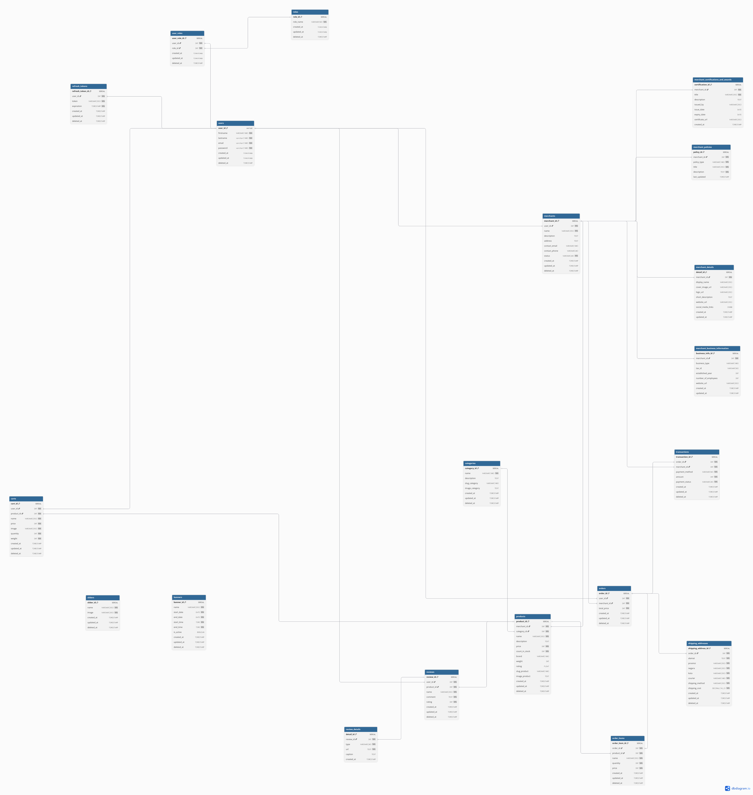

### Observability Dashboards

#### Grafana — Prometheus Metrics

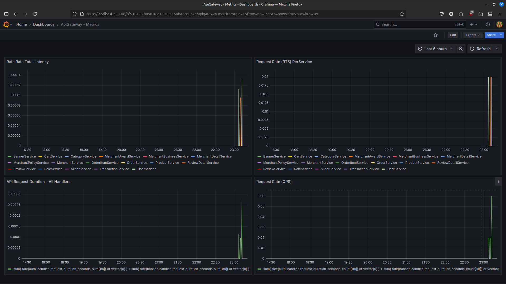

#### Prometheus — Metrics Explorer

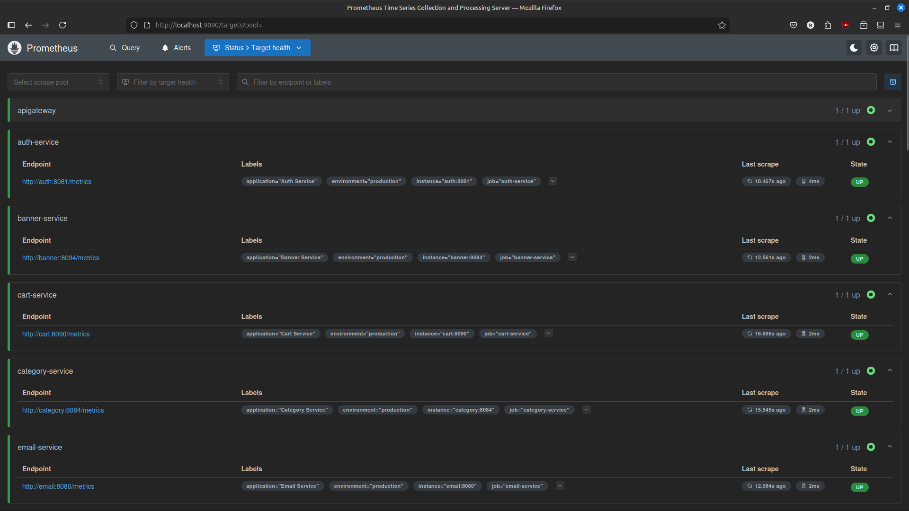

#### Prometheus — Alert Rules

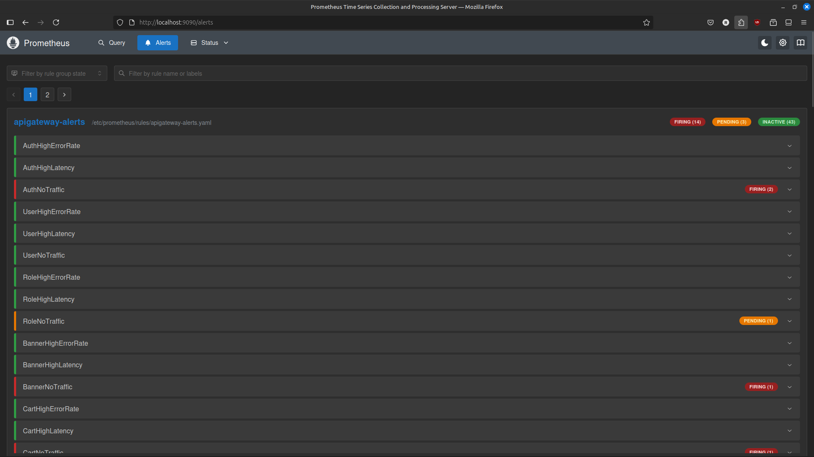

#### Loki — Log Explorer

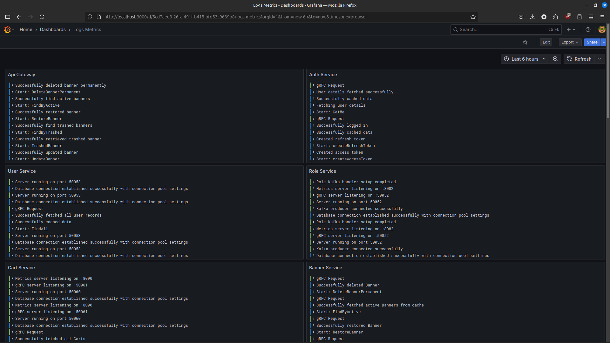

#### Jaeger — Distributed Traces

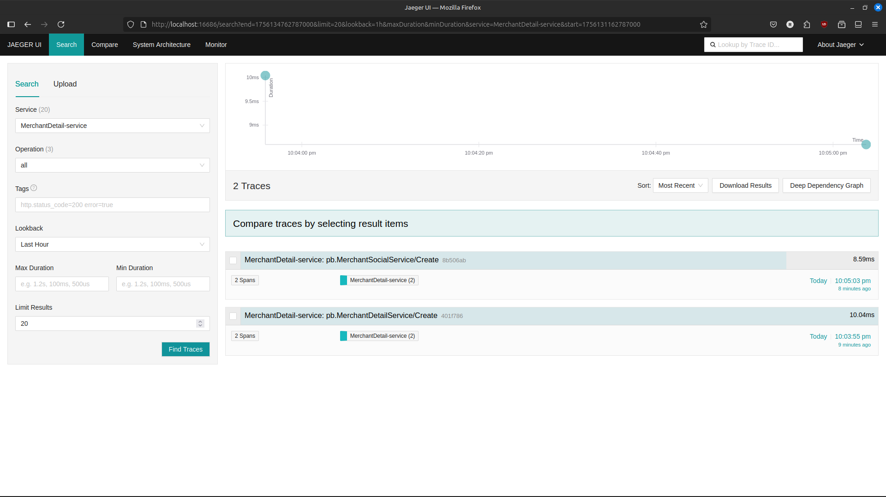

#### Node Exporter — System Metrics

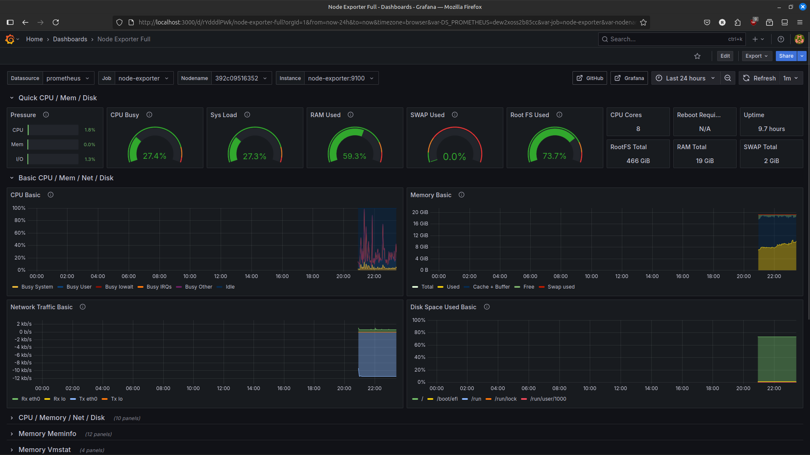

---

## License

This project is open-sourced for educational and development purposes.

---

<p align="center">
  Built with Go, gRPC, and a passion for clean microservice architecture.
</p>